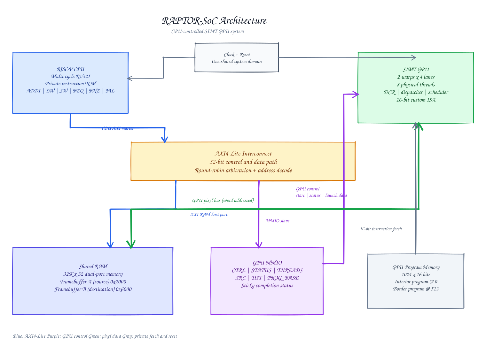

<p align="center">
  
</p>

<h1 align="center">RAPTOR-SoC</h1>

<p align="center">
  A verified RISC-V system-on-chip with a programmable SIMT GPU.
</p>

## Final SoC

RAPTOR-SoC uses SystemVerilog for the CPU, GPU, memory, and bus logic.
The RISC-V CPU controls the complete system through an AXI4-Lite bus.

The CPU configures the GPU, starts two blur passes, and reads the GPU status.
The GPU reads and writes pixels through a separate memory port.

<p align="center">
  
</p>

The final SoC has these functions:

- A multi-cycle RV32I CPU controls the GPU.
- An AXI4-Lite interconnect routes RAM and MMIO transfers.
- A dual-port RAM supports CPU transfers and GPU pixel transfers.
- GPU MMIO provides control, status, thread count, addresses, and program selection.
- A two-warp GPU runs custom 16-bit programs on eight physical lanes.
- The CPU starts the interior pass and the border pass.
- The CPU reads a sticky completion bit after each pass.

## Result

The SoC produces a clamped 3x3 box blur.
The tests compare each output pixel with an independent Python model.

<p align="center">
  
</p>

| Frame | GPU threads | SoC cycles | GPU reads | GPU writes | Mismatches |
|---:|---:|---:|---:|---:|---:|
| 16x16 | 196 + 60 | 22,066 | 2,304 | 256 | 0 |
| 32x32 | 900 + 124 | 81,970 | 9,216 | 1,024 | 0 |
| 64x64 | 3,844 + 252 | 317,362 | 36,864 | 4,096 | 0 |

Each test also confirms that the GPU does not change the source frame.
The Phase 1 through Phase 3 tests remain valid.

## Run the SoC

Install Verilator and Python 3.
Run commands from the repository root.

```sh
make soc64
```

Use these targets for more tests:

```sh
make axi       # Test the AXI4-Lite bus and protocol assertions.
make cpu       # Test the CPU instructions and stalled AXI transfers.
make soc16     # Run the 16x16 SoC test.
make soc32     # Run the 32x32 SoC test.
make soc64     # Run the 64x64 SoC test.
make phase4    # Run all Phase 1 through Phase 4 tests.
```

The SoC test creates a trace, a memory dump, and an output image in `soc/build/run/`.

## Main Parts

| Path | Purpose |
|---|---|
| `soc/rtl/` | Final SoC, AXI4-Lite bus, MMIO, and memory |
| `soc/tb/` | AXI4-Lite and complete SoC tests |
| `soc/tools/` | RISC-V assembler and SoC test driver |
| `multi_cycle/rtl/` | Multi-cycle RISC-V CPU |
| `simt_gpu/rtl/` | SIMT GPU |
| `simt_gpu/sw/kernels/` | GPU programs |
| `docs/` | Design specifications and measured results |

## CPU and GPU

The CPU supports `ADD`, `SUB`, `AND`, `OR`, `ADDI`, `LW`, `SW`, `BEQ`, `BNE`, and `JAL`.
The CPU uses a private instruction memory with 1024 words.

The GPU uses two warps with four lanes in each warp.
It runs larger workloads as a sequence of eight-thread waves.

The GPU supports arithmetic, logic, memory, compare, branch, and return instructions.
See `docs/GPU_ISA.md` for the complete instruction format.

## Documentation

- `docs/PHASE4_ASSIGNMENT.md` defines the final SoC.
- `docs/PHASE4_PROGRESS.md` records the test results.
- `docs/ADDRESS_MAP.md` defines CPU and GPU addresses.
- `docs/BUS_PROTOCOL.md` defines the GPU bus and AXI4-Lite path.
- `learning/` contains project lessons and study notes.

## Deferred Work

The current design does not include caches, interrupts, DMA, or AXI bursts.
The GPU does not include memory coalescing or per-lane branch divergence.

## License

TBD.
