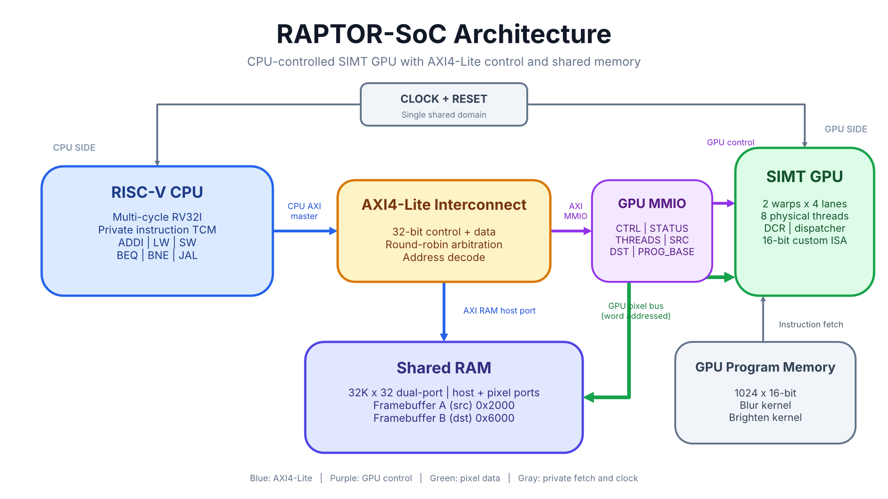

<p align="center">
  
</p>

<h1 align="center">RAPTOR-SoC</h1>

<p align="center">
  A verified RISC-V system-on-chip with a programmable SIMT GPU.
</p>

## Final SoC

RAPTOR-SoC uses SystemVerilog for the CPU, GPU, memory, and bus logic.
The RISC-V CPU controls the complete system through an AXI4-Lite bus.

The CPU configures the GPU, starts two blur passes, and reads the GPU status.
The GPU reads and writes pixels through a separate memory port.

<p align="center">
  
</p>

The final SoC has these functions:

- A multi-cycle RV32I CPU controls the GPU.
- An AXI4-Lite interconnect routes RAM and MMIO transfers.
- A dual-port RAM supports CPU transfers and GPU pixel transfers.
- GPU MMIO provides control, status, thread count, addresses, and program selection.
- A two-warp GPU runs custom 16-bit programs on eight physical lanes.
- The CPU starts the interior pass and the border pass.
- The CPU reads a sticky completion bit after each pass.

## Result

The SoC produces a clamped 3x3 box blur.
The tests compare each output pixel with an independent Python model.

<p align="center">
  
</p>

| Frame | GPU threads | SoC cycles | GPU reads | GPU writes | Mismatches |
|---:|---:|---:|---:|---:|---:|
| 16x16 | 196 + 60 | 22,438 | 2,304 | 256 | 0 |
| 32x32 | 900 + 124 | 82,362 | 9,216 | 1,024 | 0 |
| 64x64 | 3,844 + 252 | 317,774 | 36,864 | 4,096 | 0 |

Each test also confirms that the GPU does not change the source frame.
Cycle counts include firmware register initialization but exclude boot-port loading.
The Phase 1 through Phase 3 tests remain valid.

## Synthesis Results

The RAPTOR-SoC core was synthesized in **Synopsys Design Compiler** using the **FreePDK45 `gscl45nm` standard-cell library**.
The CPU, GPU, AXI interconnect, and MMIO use a **shared 50 MHz clock**.
Pre-layout timing analysis of the mapped core meets setup and hold at a **20 ns clock period**.
Instruction and data memories are external to the synthesized core. CPU and GPU register files are included.

| Metric | Result |
|---|---:|
| Shared clock target | **50 MHz** |
| Setup slack | **+0.771 ns** |
| Hold slack | **+0.0476 ns** |
| Leaf cells | 105,655 |
| Sequential cells | 5,356 |
| Total cell area | 342,988.84 library area units |

Timing uses a 0.1 ns clock transition, 0.2 ns setup uncertainty, and 0.05 ns hold uncertainty.
The constraint sweep re-analyzes the same mapped netlist without changing the RTL or repeating synthesis.

## Run the SoC

Install Verilator and Python 3.
Run commands from the repository root.

```sh
make soc64
```

Use these targets for more tests:

```sh
make axi       # Test the AXI4-Lite bus and protocol assertions.
make cpu       # Test the CPU instructions and stalled AXI transfers.
make soc16     # Run the 16x16 SoC test.
make soc32     # Run the 32x32 SoC test.
make soc64     # Run the 64x64 SoC test.
make phase4    # Run all Phase 1 through Phase 4 tests.
```

The SoC test creates a trace, a memory dump, and an output image in `soc/build/run/`.

## Synthesize with Synopsys Design Compiler

The synthesis top is `soc_top`.
Use `dc-core` to synthesize all SoC logic without the three large memory arrays.
This target includes the CPU, GPU, AXI bus, MMIO, and CPU/GPU register files.
It exposes the excluded memories as ports, not black boxes or constant data.
It does not instantiate SRAM macros or change instruction execution.

Simulation and synthesis use the RTL list in `soc/rtl/files.txt`.
The core flow excludes `shared_ram.sv`, `program_memory.sv`, and `instruction_memory.sv` from analysis.
The RTL does not use file initialization or hierarchical writes to initialize hardware.

Run the local checks first:

```sh
make lint
make core-test
make boot
make phase4
```

On the ADDV lab server, load the environment from the repository root.
For Bash, use:

```bash
source synth/env.sh
make dc-core-elab
make dc-core
```

For csh or tcsh, use:

```csh
source synth/env.csh
make dc-core-elab
make dc-core
```

These files use the DC installation, license server, and FreePDK45 paths from ADDV Lab 2.
They preserve existing environment settings.
Set `DC_HOME` before sourcing to select a different DC installation.
The setup does not need VCS, Verdi, or an SRAM library.

On another machine, load its DC environment and set the absolute `.db` path:

```sh
export TARGET_LIBRARY='/absolute/path/to/standard_cells.db'
export DC_CLOCK_PERIOD=20.0
make dc-core-elab
make dc-core
```

`TARGET_LIBRARY` accepts a Tcl list of `.db` paths.
Use braces around a path that contains spaces.
Use `LINK_LIBRARY` for additional libraries.
Use `DC_SHELL` to select another DC executable.
Use `DC_OUT_DIR` to select another output directory.

The flow uses `compile_ultra` and the installed DesignWare library.
Make sure the required licenses are available.
The core flow writes reports to `synth/build/core/reports/`.
It writes the mapped Verilog, DDC, and SDC files to `synth/build/core/results/`.
The `dc-core-elab` target stops before technology mapping.
The `reports/scope.rpt` file identifies the included and excluded hardware.

To inspect an existing mapped core without recompilation, run `make dc-core-report`.
This target reads `synth/build/core/results/soc_top.ddc` and preserves its saved constraints.
It adds detailed hold, constraint, clock, port, unit, and timing-coverage reports.
The detailed constraint report uses six decimal places to show small capacitance limits.
Copy these diagnostic reports to `synth/results/core/` for review.
Do not publish the mapped DDC file.

### Constraint experiments without synthesis

Run `make dc-core-sweep` to analyze the saved mapped core under seven constraint scenarios.
This target does not compile, change the RTL, or overwrite the mapped DDC.
It writes `synth/build/core/reports/sweep/summary.csv` and per-scenario reports and SDC files.

The first scenario preserves the saved constraints.
The next scenarios isolate hold uncertainty and clock transition changes before combining them.
Further scenarios reduce setup uncertainty and test 15 ns and 10 ns periods.
The experimental values are assumptions, not measured clock specifications.
The sweep keeps input transition, I/O delays, and output load fixed across the reconstructed scenarios.
It does not change library capacitance limits or suppress hold checks.

Compare the saved baseline with its existing reports before interpreting the other scenarios.
An improvement from changed assumptions does not prove that the assumptions are correct.
Shorter-period failures describe this mapped netlist, not the result of resynthesis at those periods.
No scenario establishes complete-SoC timing or a validated maximum frequency.

For later synthesis runs, the constraints accept these environment overrides:

- `DC_SETUP_UNCERTAINTY`, `DC_HOLD_UNCERTAINTY`, and `DC_CLOCK_TRANSITION`
- `DC_INPUT_TRANSITION`
- `DC_INPUT_DELAY_MIN`, `DC_INPUT_DELAY_MAX`, `DC_OUTPUT_DELAY_MIN`, and `DC_OUTPUT_DELAY_MAX`
- `DC_OUTPUT_LOAD` in pF for the current library

Time values use the library time unit, which is ns for the current library.
Without overrides, the original constraint values remain unchanged.

The original `make dc-elab` and `make dc` targets still include all three memories as registers.
Those targets use `synth/build/` and can need substantial runtime and host memory.

The default constraints are starting values, not timing-signoff requirements.
Review `synth/constraints.tcl` for the selected library and external interface.
Time values use the library's time unit, normally nanoseconds.
Do not constrain `reset` or the boot inputs to constants during synthesis.
The memories need these inputs for initialization.

### Core memory interfaces

The `dc-core` target defines `RAPTOR_EXTERNAL_MEMORIES`.
Without this define, `soc_top` keeps the original internal memories and ports.
With this define, `soc_top` adds these memory ports:

| Port group | Interface |
|---|---|
| `cpu_imem_*` | 32-bit instruction read, 32-bit byte address, and a boot write port with a 10-bit word address |
| `gpu_program_*` | 16-bit instruction read with a 10-bit word address, and a boot write port |
| `ram_px_*` | GPU RAM port with a 15-bit word address and 32-bit data |
| `ram_host_*` | CPU/boot RAM port with a 15-bit word address and 32-bit data |

External memories must provide asynchronous reads and writes on the rising edge of `clk`.
The CPU memory selects a word with `cpu_imem_addr[11:2]`, as in the original design.
The GPU program address includes `prog_base` and wraps at 1024 words.
All memory writes use active-high enables.
If both RAM ports write the same word, the host write must take priority.
Boot writes remain valid only while `reset=1`.

The default constraints apply I/O timing budgets to these ports.
They do not model a physical memory or its address-to-data delay.
Core area excludes the three memories, and core timing does not establish complete-SoC timing.
Actual memory integration still needs a compatible implementation and timing verification.

Run `make core-test` to test the core with external memory models.
The test uses the existing 16x16, 32x32, and 64x64 blur checks through the exported ports.

### Hardware initialization

The `soc_top` boot port uses the same `clk` as the processors.
Writes occur on the rising edge only when `reset=1` and `boot_we=1`.
All boot addresses are word indices, not byte addresses.

| `boot_sel` | Destination | Valid `boot_addr` | Data |
|---:|---|---|---|
| 0 | CPU instructions | 0–1023 | `boot_wdata[31:0]` |
| 1 | GPU instructions | 0–1023 | `boot_wdata[15:0]` |
| 2 | Shared RAM | 0–32767 | `boot_wdata[31:0]` |
| 3 | Reserved | None | Writes have no effect |

1. Assert `reset`.
2. Write the CPU program, GPU programs, and required RAM contents through the boot port.
3. Clear `boot_we`.
4. Deassert `reset` with the required clock timing.

The CPU starts at address zero.
The generated firmware initializes its own registers with supported instructions.
Boot writes have no effect while the processors run.
Reset preserves all memory contents.
While `reset=1`, `boot_rdata` gives asynchronous RAM readback when `boot_sel=2`.
Otherwise, `boot_rdata` is zero.
The port does not provide instruction readback.
Initialize each memory location before the processors read it.

### Memory and timing limits

The shared RAM contains 1,048,576 bits with two asynchronous read ports and two synchronous write ports.
The CPU and GPU instruction memories add 49,152 bits.
Without explicit memory-macro integration, DC can implement these arrays with registers and multiplexers.
This implementation can need substantial area, runtime, and host memory.
Adding a memory `.db` to the library list alone does not replace the RTL arrays with that macro.
A synchronous SRAM macro also needs changes to the memory protocols.

The GPU uses combinational 32-bit multiplication and division in each lane.
These operations are synthesizable, but they can dominate area and timing.
Check the mapped reports before you select a clock frequency.

## Main Parts

| Path | Purpose |
|---|---|
| `soc/rtl/` | Final SoC, AXI4-Lite bus, MMIO, and memory |
| `soc/tb/` | AXI4-Lite and complete SoC tests |
| `soc/tools/` | RISC-V assembler and SoC test driver |
| `multi_cycle/rtl/` | Multi-cycle RISC-V CPU |
| `simt_gpu/rtl/` | SIMT GPU |
| `simt_gpu/sw/kernels/` | GPU programs |
| `docs/` | Design specifications and measured results |

## CPU and GPU

The CPU supports `ADD`, `SUB`, `AND`, `OR`, `ADDI`, `LW`, `SW`, `BEQ`, `BNE`, and `JAL`.
The CPU uses a private instruction memory with 1024 words.

The GPU uses two warps with four lanes in each warp.
It runs larger workloads as a sequence of eight-thread waves.

The GPU supports arithmetic, logic, memory, compare, branch, and return instructions.
See `docs/GPU_ISA.md` for the complete instruction format.

## Documentation

- `docs/PHASE4_ASSIGNMENT.md` defines the final SoC.
- `docs/PHASE4_PROGRESS.md` records the test results.
- `docs/ADDRESS_MAP.md` defines CPU and GPU addresses.
- `docs/BUS_PROTOCOL.md` defines the GPU bus and AXI4-Lite path.
- `learning/` contains project lessons and study notes.

## Deferred Work

The current design does not include caches, interrupts, DMA, or AXI bursts.
The GPU does not include memory coalescing or per-lane branch divergence.

## License

TBD.
